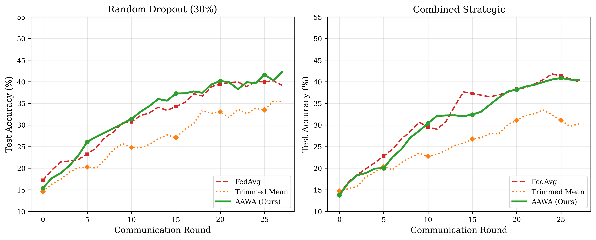

<div align="center">

# Adversary-Aware Aggregation for Federated Learning

**AAWA: reweighting federated-learning clients when an adversary suppresses some of them**

[](#summary)
[](#citation)
[](LICENSE)
[](requirements.txt)
[](#replication-note)

</div>

## Summary

Robust federated learning usually defends against clients that send bad updates. This project looks at a different adversary: one that watches traffic in a contested edge network and suppresses the clients whose data matters most. Adversary-Aware Weighted Aggregation (AAWA) uses each client's participation history and data similarity to flag likely suppression, then up-weights participating clients whose data resembles that of the missing ones. The paper is accepted at the 1st International Conference on Computing, Communication, and Artificial Intelligence (IC3AI), Dr. B. R. Ambedkar NIT Jalandhar, with proceedings to follow the conference in April 2027.

## Key findings (as reported in the paper)

Non-IID CIFAR-10 (Dirichlet α = 0.1), 20 clients, 30 rounds, one seed; final test accuracy in %:

| Attack | FedAvg | Trimmed mean | AAWA |
|---|---|---|---|
| None | 44.25 | 37.67 | 44.20 |
| Random dropout, 30% | 36.73 | 34.95 | 43.88 |
| Combined strategic suppression, 30% | 40.51 | 31.00 | 40.84 |

- AAWA recovered 7.15 points over FedAvg under random dropout and 0.33 points under combined strategic suppression.
- The trimmed mean did worse than FedAvg even without an attack, because with heterogeneous data honest clients look like outliers to each other.

<p align="center">
  
  <br><sub>Test accuracy over 30 rounds under random dropout and combined strategic suppression (run 3, the configuration in the paper).</sub>
</p>

## Replication note

These results come from single runs. A later pre-registered study re-tested AAWA with three and then five seeds, deterministic GPU execution and 100 rounds, and found its gains indistinguishable from zero. At round 30 of those runs, AAWA's gain over FedAvg on CIFAR-10 was −0.22 [−1.48, 1.03] points under random dropout and −1.16 [−2.95, 0.64] under combined suppression (5 seeds, 95% intervals, exploratory). The follow-up, with its code, pre-registrations and results, is at [research-fl-strategic-client-silence](https://github.com/ziyam-khan/research-fl-strategic-client-silence). It also explains why reweighting cannot help much here: the classes a strategic adversary removes sit almost entirely on the silenced clients.

## Repository layout

| Path | Contents |
|---|---|
| [`src/aggregators.py`](src/aggregators.py) | FedAvg, trimmed mean, coordinate-wise median and AAWA |
| [`src/attacks.py`](src/attacks.py) | Suppression schedules: random dropout and strategic (gradient, distribution, combined) |
| [`src/data.py`](src/data.py), [`src/model.py`](src/model.py) | Dirichlet client splits, datasets and models |
| [`src/run_experiments.py`](src/run_experiments.py) | Main experiment and suppression-rate sweep; writes `results/` |
| [`src/plot_results.py`](src/plot_results.py) | Figures |
| [`results/`](results/) | Raw results of the four runs below |
| [`figures/`](figures/) | Figures (files ending `_r4` are from run 4) |

## Reproduce

```bash
git clone https://github.com/ziyam-khan/research-fl-adversary-aware-aggregation && cd research-fl-adversary-aware-aggregation
python3 -m venv .venv && . .venv/bin/activate && pip install -r requirements.txt
python src/run_experiments.py      # downloads CIFAR-10 into data/, writes results/
python src/plot_results.py         # figures
```

`run_experiments.py` is set to 100 rounds (run 4). Set `ROUNDS = 30` to reproduce run 3, the configuration reported in the paper. Seed: 42.

## How the study was run

| Run | Setting | Time on the GPU | Outcome |
|---|---|---|---|
| 1 | MNIST, Dirichlet α = 0.5, 100 rounds | about 10 h | Failed: all methods reached similar accuracy, so suppression showed no effect |
| 2 | MNIST, α = 0.1, 50 rounds | about 4.8 h | Failed for the same reason: MNIST is too easy for suppression to hurt |
| 3 | CIFAR-10, α = 0.1, 30 rounds | about 5 h | The results reported in the paper |
| 4 | CIFAR-10, α = 0.1, 100 rounds | about 14 h | Longer training; AAWA +2.82 points under combined suppression (not in the paper) |

A fifth run on a university cluster used a different batch size by mistake and is excluded.

## Compute

All four runs used a laptop GPU, an NVIDIA GeForce GTX 1650, in full fp32 precision (times in the table above). Library versions were not recorded at the time; [`requirements.txt`](requirements.txt) lists the packages. The follow-up study's compute is documented in [its repository](https://github.com/ziyam-khan/research-fl-strategic-client-silence#compute).

## Citation

```bibtex
@inproceedings{khan2027aawa,
  author    = {Khan, Ziyam},
  title     = {Adversary-Aware Aggregation for Federated Learning on Contested Edge Networks},
  booktitle = {Proc. 1st Int. Conf. Comput., Commun., Artif. Intell. (IC3AI)},
  address   = {Jalandhar, India},
  year      = {2027},
  note      = {Accepted, to appear}
}
```

[`CITATION.cff`](CITATION.cff) has the same information for GitHub's "Cite this repository" button.

## License

Code: [MIT](LICENSE). Results and figures: [CC BY 4.0](https://creativecommons.org/licenses/by/4.0/). The datasets are downloaded from their sources under their own terms.

## Author

**Ziyam Khan**, Parul University, Vadodara, India. ORCID [0009-0000-1943-8481](https://orcid.org/0009-0000-1943-8481).
